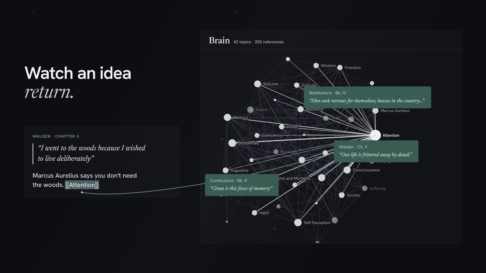
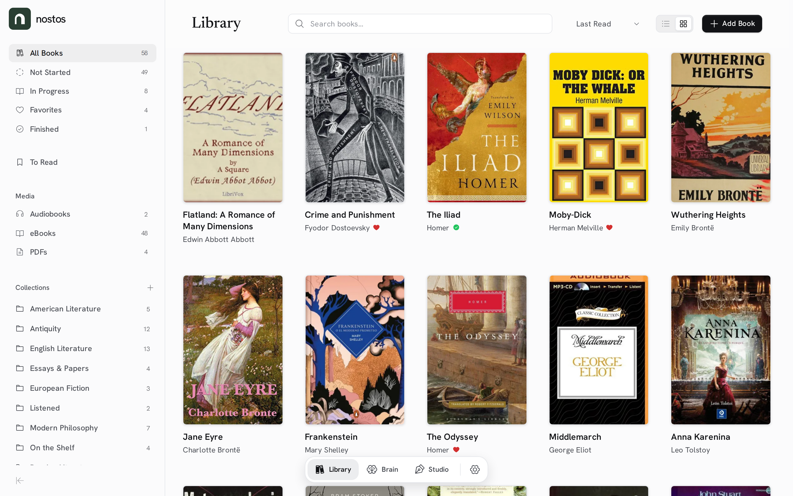
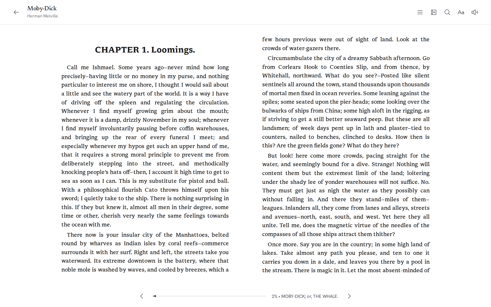
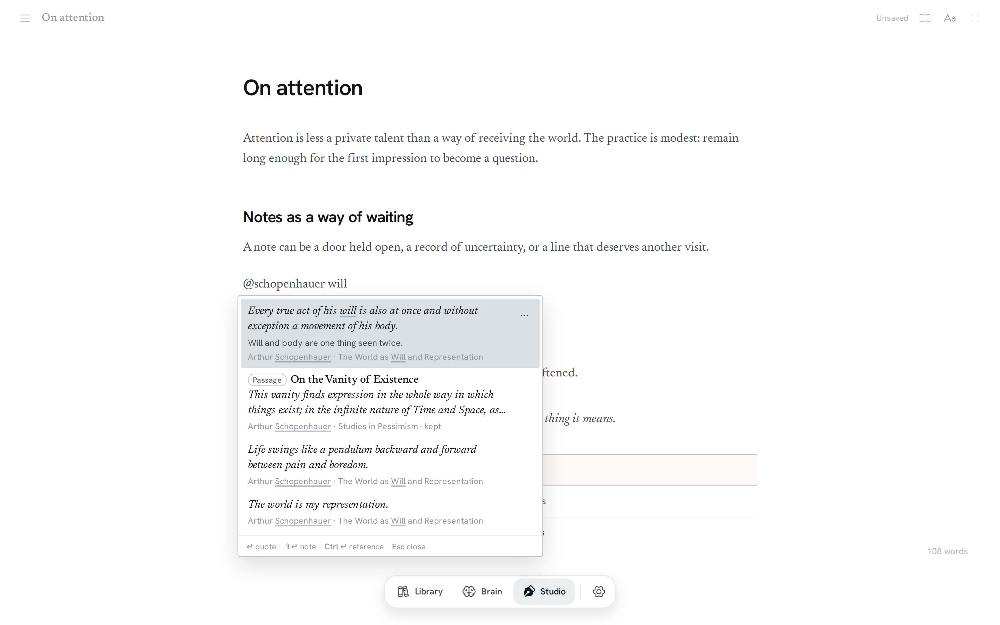
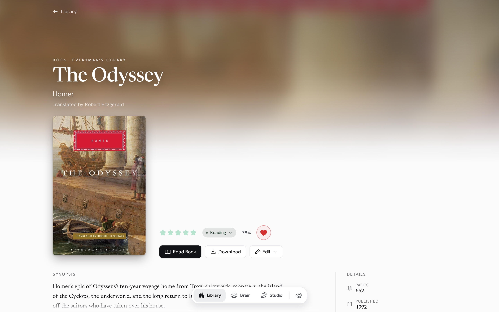
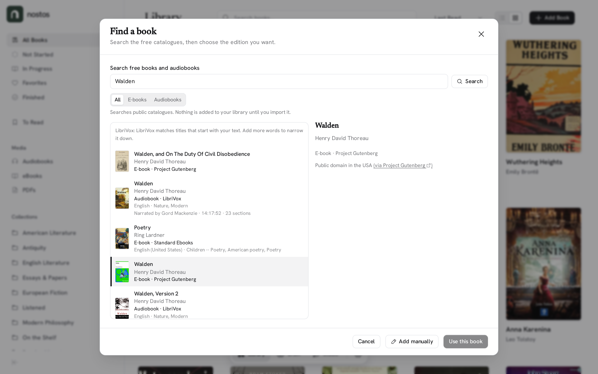

<div align="center">
  <picture>
    <source media="(prefers-color-scheme: dark)" srcset="docs/brand/logo-dark.svg" />
    <source media="(prefers-color-scheme: light)" srcset="docs/brand/logo-light.svg" />
    
  </picture>

  <p><strong>A home for your reading life.</strong></p>
  <p>Bring your books together, keep your thoughts with their source, and turn what you read into your own writing.</p>

  <p>
    <a href="https://nostos.page">Website</a> •
    <a href="https://docs.nostos.page">Docs</a> •
    <a href="#features">Features</a> •
    <a href="#getting-started">Getting started</a> •
    <a href="#license--trademark">License</a>
  </p>
</div>

<hr>

<div align="center">
  <a href="https://nostos.page">
    
  </a>
  <p><em>Watch the launch film on <a href="https://nostos.page">nostos.page</a></em></p>
</div>

## What is Nostos?

Nostos keeps reading, thinking and writing in one place. Collect your physical books, EPUBs, PDFs and audiobooks. Read or listen in the app, save highlights, notes and whole passages next to the page they came from, connect ideas across books, and bring it all into a draft when you are ready to write.

It follows one simple loop: **Read → Notice → Capture → Return → Write.**

It is deliberately quiet. There are no feeds, streaks or scores. The optional assistant stays out of the way until you ask for it.

You can use the hosted service, [Nostos Cloud](https://nostos.page), or run it yourself. This repository is the complete, open-source **SelfHosted** app.

---

## Features

### Library

- **Every kind of book in one place:** physical books, EPUB, PDF, TXT, MOBI and audiobooks (MP3, M4A, M4B). Audiobooks split into many files play as one book.
- **Free books, built in:** search Project Gutenberg, Standard Ebooks, Wikisource and LibriVox from **Add a book**. Litteraturbanken (Swedish literature) is available to turn on.
- **Collections and editions:** nested collections, drag and drop, and editions of the same work grouped together.
- **A To read list:** keep the books you want but don't own yet, with a short **Next up** shelf.
- **Search everything:** press <kbd>Ctrl</kbd>/<kbd>⌘</kbd>+<kbd>K</kbd> to find books, topics, notes and documents. Search forgives typos.

<div align="center">
  
</div>

### Reading & listening

- **Readers for every format:** an EPUB reader with adjustable typography, a PDF reader, and an audiobook player with chapters, speed control and a sleep timer.
- **Highlights and notes on the page:** select text to highlight it, and click a highlight to open its note.
- **Passages:** save a long stretch of a book, a range of PDF pages or a clip of an audiobook, and read or play it again on its own.
- **Switch between ebook and audiobook:** if you have both editions, continue in the other one near where you are.
- **Read aloud:** listen to any EPUB or PDF with your device's voice or a natural voice from a speech server.
- **Bring your e-reader highlights:** import highlights from Kobo and KOReader, review them, then add them to the right books.

<div align="center">
  
</div>

### Brain

The Brain is where notes from different books meet.

- **Topics:** link ideas with `[[Topic]]` in any note, and browse them as a list or an interactive map.
- **Back to the source:** every topic leads back to the notes, passages and books behind it.

<div align="center">
  
</div>

### Writing Studio

- **Opens on the page:** a blank sheet with the caret in it; your files and references slide in when you want them, and the chrome fades while you type.
- **Type `@` to quote:** find a note, quote or passage by its words, book or author (`@schopenhauer will`) and put it on the page with its attribution. A long passage opens so you can pick the sentences you want.
- **`/` for blocks:** headings, lists, a divider, an image, a table or code from an empty line.
- **Make the page yours:** Studio themes, typefaces, size, spacing and width, a typewriter mode that keeps the current line centred, and optional typewriter sounds.
- **Saves as you type,** as plain Markdown.

<div align="center">
  
</div>

<details>
  <summary><strong>More screenshots</strong></summary>
  <br />
  <table>
    <tr>
      <td width="50%">
        <strong>Book page</strong><br /><br />
        
      </td>
      <td width="50%">
        <strong>Add a book</strong><br /><br />
        
      </td>
    </tr>
    <tr>
      <td colspan="2">
        <strong>Brain topics and notes</strong><br /><br />
        
      </td>
    </tr>
  </table>
</details>

### Ask Nostos (optional)

Ask Nostos is an AI assistant for your own library. It can find what you have read, help you capture a thought, or reorganise your collections. When it changes your library, it shows one set of changes you can undo, or review before anything happens. Nostos works fully without it.

On SelfHosted, you connect your own AI provider in **Settings → AI connections**. Nostos Cloud includes a managed allowance.

### Your library stays yours

- **Portable:** export your whole library as a `.nostos` archive and import it into any Nostos, hosted or self-hosted.
- **Use the files you already have (SelfHosted):** point Nostos at a folder of books on your server. It reads them in place and never changes them.
- **Backups:** SelfHosted has local backup and restore. Nostos Cloud makes daily managed backups, which you can see in Settings.
- **OPDS:** browse and download your library from compatible e-reader apps.

---

## Getting started

### Nostos Cloud

The easiest way to start: **[get started at nostos.page](https://nostos.page/start)** and see [plans and pricing](https://nostos.page/pricing).

### Self-host with Docker

```bash
docker volume create nostos-data
docker run -d \
  --name nostos \
  -p 5099:8080 \
  -v nostos-data:/data \
  --restart unless-stopped \
  ghcr.io/christian-gennari/nostos:latest
```

Or use the included Compose file: `docker compose up -d`. Then open **http://localhost:5099**. No account or subscription needed.

Everything Nostos keeps lives in the `/data` volume: the database, your books, local backups and the key ring in `/data/keys` that protects AI keys saved in Settings. Back up the whole volume, and keep it when you replace the container.

- **Update:** `docker compose pull && docker compose up -d`. `latest` is published only after the full CI passes on `main`. To pin a build, set `NOSTOS_IMAGE_TAG=selfhosted-sha-<commit>`. Older `sha-*` tags are not SelfHosted builds.
- **Books already on your server:** mount the folder at `/external/media` (read-only), then open **Settings → This server → External media**. See the [External media guide](docs/external-media.md).
- **Coming from an older image?** Older images kept the key ring inside the container. Copy it into `/data/keys` before you replace the container, or re-enter your AI keys afterwards.

The [self-hosting docs](https://docs.nostos.page/get-started/quickstart/) cover requirements, reverse proxies, backups and updates.

### Run from source

You need the [.NET 10 SDK](https://dotnet.microsoft.com/download) and [Node.js LTS](https://nodejs.org/).

```bash
git clone https://github.com/Christian-Gennari/Nostos.git
cd Nostos
npm install
npm --prefix Nostos.Frontend install
npm start        # development: http://localhost:4200
npm run prod     # production build: http://localhost:5099
```

Outside Docker, the database defaults to `<content root>/nostos.db`. Override paths with `Persistence__DatabasePath`, `Storage__BooksRoot`, `Storage__BackupsRoot` and `DataProtection__KeysPath`. See [Getting started (development)](docs/getting-started.md) for details.

---

## How it's built

Nostos is one product with two deployments. **SelfHosted** (this repository) runs on its own with SQLite, local files, local backups and your own AI provider. **Nostos Cloud** adds private hosting pieces (sign-in, managed storage, billing, managed AI) around the same product and the same app. See the [public/private boundary](docs/adr/cloud-public-private-boundary.md).

```text
Nostos/
├── Nostos.Product/    # the product: domain, application and API behaviour
├── Nostos.Backend/    # the SelfHosted host: SQLite, local files, backups, your own AI keys
├── Nostos.Shared/     # shared DTOs and contracts
├── Nostos.Frontend/   # the Angular app, shared by SelfHosted and Cloud
└── docs/              # product, architecture and operations docs
```

**Stack:** [.NET 10](https://dotnet.microsoft.com/) Minimal APIs, EF Core 10 and SQLite · [Angular 21](https://angular.dev/) with Signals · epub.js · ngx-extended-pdf-viewer · Howler.js · Sigma.js and Graphology · TipTap with marked and Turndown · Phosphor icons · Newsreader and Hanken Grotesk.

**Design:** warm paper surfaces, a restrained forest green, literary type and quiet controls. The mark is a doorway and a lowercase `n`: a Forest Green (`#293E32`) tile with a White (`#FFFFFF`) arch, the same in light and dark themes. Read the [Design Manifesto](docs/design-manifesto.md) or browse the [brand assets](_brand-assets/README.md).

---

## Documentation

- **[docs.nostos.page](https://docs.nostos.page):** guides for Nostos Cloud and self-hosting.
- **[Releases](https://github.com/Christian-Gennari/Nostos/releases):** what's new. How releases are made: [docs/releases.md](docs/releases.md).
- **Guides in this repo:** [External media](docs/external-media.md) · [Read aloud](docs/read-aloud.md) · [Content providers](docs/content-providers.md) · [Library portability](docs/cloud/portability.md) · [SelfHosted activation & recovery](docs/selfhosted-activation-recovery.md)
- **For developers and agents:** [REST API](Nostos.Backend/_docs/endpoints.md) · [Library skill for agents](.agents/skills/nostos-library/SKILL.md) · [Deployment capabilities](docs/cloud/deployment-modes.md) · [PostgreSQL compatibility](docs/cloud/postgresql-compatibility-spike.md)
- **[Security policy](SECURITY.md):** how to report a vulnerability.

Work in progress is tracked in [GitHub Issues](https://github.com/Christian-Gennari/Nostos/issues).

---

## License & Trademark

Nostos is licensed under the **[GNU General Public License v3.0 or later](./LICENSE)**. You may run, study, modify, and redistribute the software under those terms.

The Nostos name, related word marks, and official visual identity are not granted by the GPL. Distributed forks and derivative builds must use independent naming and branding. See [TRADEMARK.md](./TRADEMARK.md) for the full policy.

The EPUB reader bundles the **[Libron](https://github.com/nicoverbruggen/libron)** typeface (© Nico Verbruggen, derived from Readerly and Newsreader), licensed separately under the [SIL Open Font License 1.1](./Nostos.Frontend/public/fonts/libron/OFL.txt).
