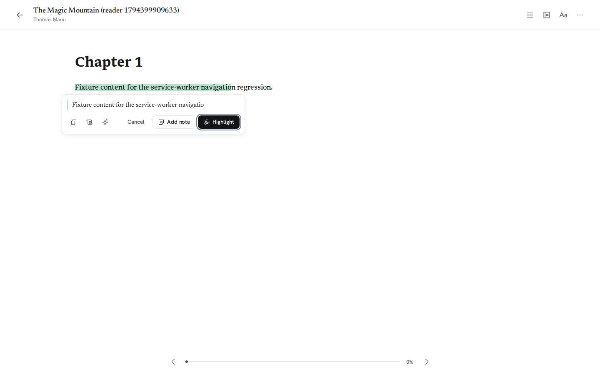
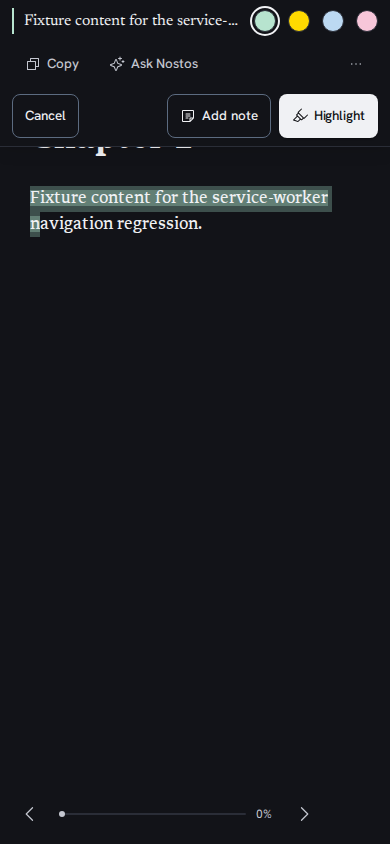
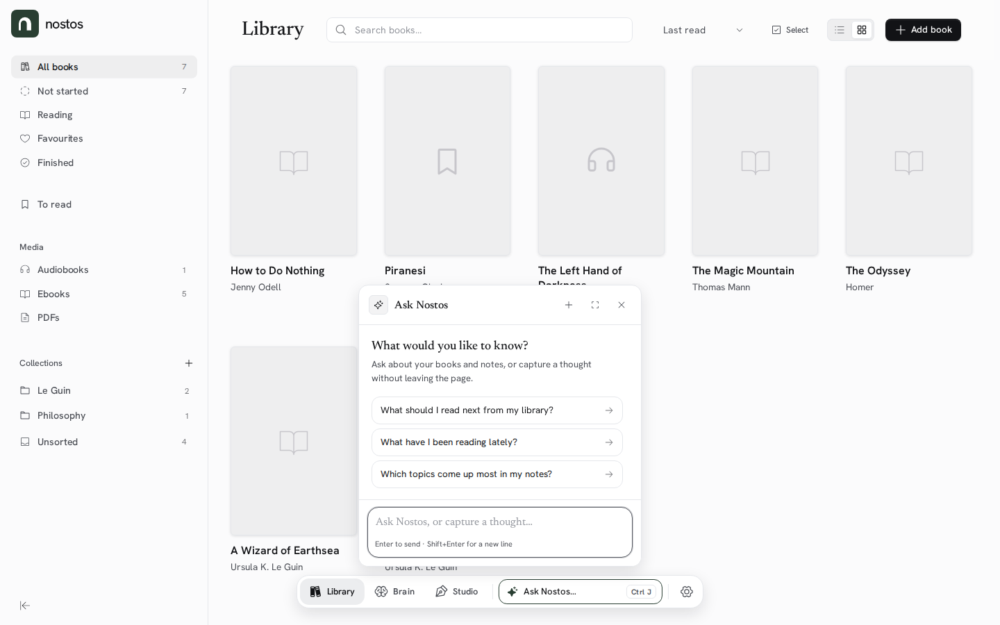
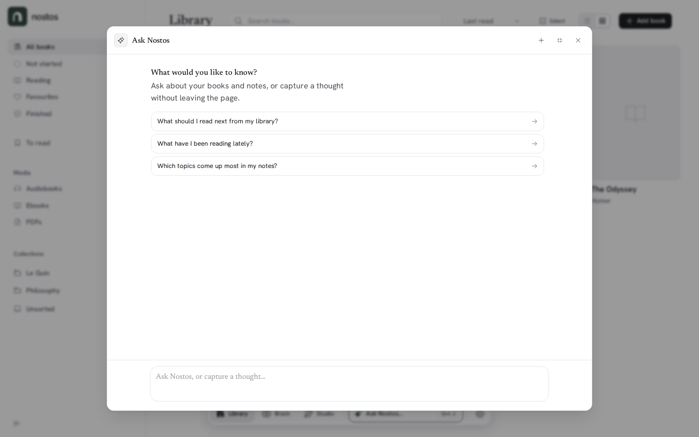
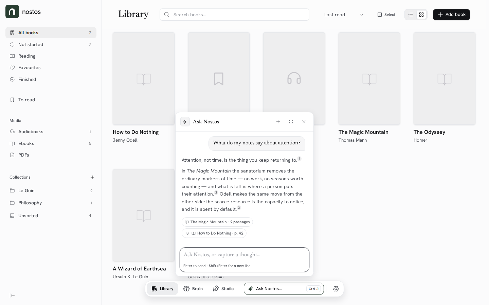
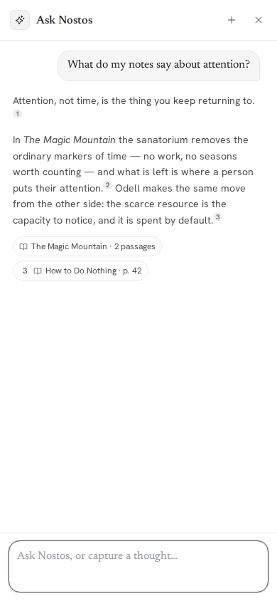
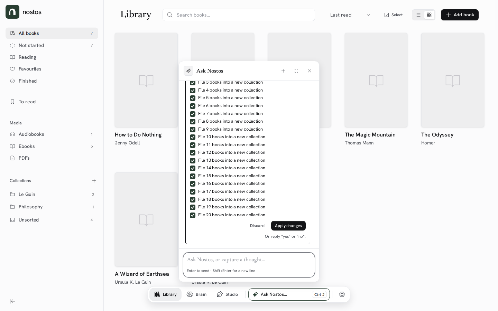
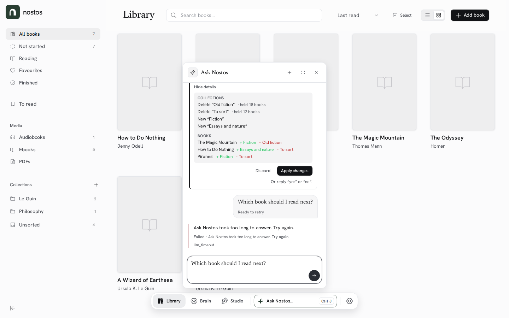
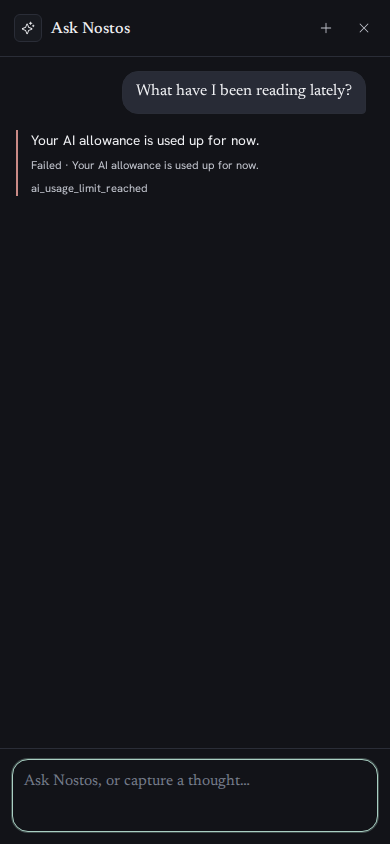
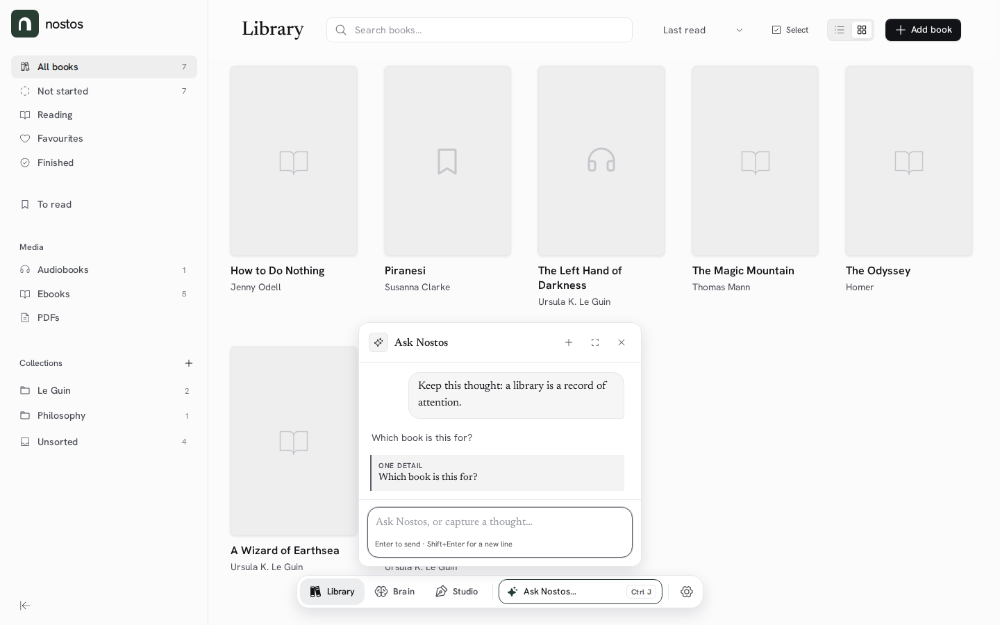

# Ask Nostos — assessment (#1464)

> **Archived 2026-11-13.** Point-in-time evidence (screenshots and measurements)
> taken for the #1464 polish plan; it is not a description of the app today.

Status: **assessment complete; live-model parts pending** · Base: `main` @ `f200e10c` · Date: 2026-11-11

This is the evidence for the polish plan in `docs/archive/ask-nostos-polish-plan.md`. It
covers what Ask Nostos can do, what it says it can do, how it fails, and what it
looks like. The concrete fixes and the ready-to-file sub-issues live in the plan.

> **Limits of this assessment.** No live model was available, and none was
> configured or called. Every assistant turn in the screenshots is a scripted
> stub (the same technique as `e2e/reader-ask-quote-highlight.spec.ts:88`),
> rendered by the real Angular app against the real backend and a real
> SQLite library. Entry points, layout, states, error rendering and copy were
> exercised for real; **answer quality, tool choice and run-to-run consistency
> were not** and are marked *Pending: needs a live model* (§6).

## 1. Verdict

The machinery underneath is stronger than the surface above it. Changesets,
undo, review policy, taint handling, typed failures and the quality bed are real
and tested. The panel, however, presents Ask Nostos as a generic chat box with
three suggested questions:

- its **capability story is only in the system prompt, the docs and the README**
  — the in-app copy names two of four jobs (`assistant.component.html:81`,
  `settings.component.html:687`);
- **failures are rendered as developer traces** — the same sentence up to three
  times, ending in a raw code (`assistant.component.html:105-130`,
  `assistant.service.ts:1642`, screenshots 07/08/25);
- **a tall review card arrives with its title, headline and first steps scrolled
  out of view** (`assistant.component.ts:898-906`, screenshot 06b: the label sits
  at y=33 while the transcript viewport starts at y=234);
- **a retryable failure has no retry control** — only the words “Ready to retry”
  and a pre-filled composer (`assistant.service.ts:1455`);
- the panel is a **fixed 408 px card** with six different corner radii, two of
  them not in the design-token graph (`assistant.component.css:147,339,423,861`;
  `assistant-changeset-card.component.css:12`).

Nothing here needs a new AI feature. It needs the product the app already has to
be visible, honest and consistent.

## 2. What it can do

The only action surface is the capability registry
(`Nostos.Product/Integrations/Assistant/AssistantCapabilityRegistry.cs:1-70`).
Ask Nostos builds its tools from `For(AssistantSurface.AskNostos)`
(`AssistantConversationBuilder.cs:76-82`): **34 capabilities**. Two more are
MCP-only. The full pinned list is
`Nostos.Backend.Tests/Assistant/AssistantCapabilityRegistryTests.cs:33-69`.

Legend for *where claimed*: **Empty** = the empty state
(`assistant.component.html:78-99`), **Starters** = page starters
(`assistant.component.ts:49-99`), **Composer** = the field placeholder
(`assistant.component.html:474`), **Settings** = the Assistant card
(`settings.component.html:664-730`), **Prompt** = the model-facing behaviour
contract (`AssistantConversationBuilder.cs:93-165`), **README** = `README.md:125-129`,
**Docs** = `docs/ask-nostos-library-changes.md` and the quality gate.

### 2.1 Ask your library (read)

| Capability | Where implemented | Where claimed | Gap |
| --- | --- | --- | --- |
| `knowledge_search` (notes, topics, imported text) | `AssistantCapabilities.Knowledge.cs:16` | Empty; Starters; Prompt:160; README | None, but “search” is assumed to cover audiobooks and paper books; it does not (§3.3). |
| `knowledge_overview` | `…Knowledge.cs:62` | Prompt:160 only | Not named in-app. |
| `knowledge_read_evidence` | `…Knowledge.cs:81` | Source rows imply re-open (`assistant.component.html:121-270`) | Fine. |
| `notes_list_for_book` | `…Knowledge.cs:125` | Reader starter “What have I noted from …?” (`assistant.component.ts:60`) | None. |
| `notes_search` | `…Knowledge.cs:151` | Empty (“your books and notes”) | None. |
| `notes_list_unlinked` | `…Knowledge.cs:179` | Brain starter about sparse topics (`assistant.component.ts:74`) | Indirect only. |
| `notes_read_for_review` | `…Knowledge.cs:205` | Brain review context (`AssistantConversationBuilder.cs:44-52`) | Invisible; it only works when the user is already in a Brain review. |
| `topics_list` / `topics_search` / `topics_get` | `…Knowledge.cs:235,254,281` | Brain starters; Prompt:160 | `topics_get` is not named anywhere. |
| `topics_propose_links` | `…Knowledge.cs:346` | Suggestion block (`assistant.component.html:292-315`) | The block appears only in the Brain; nothing explains it. |
| `library_resolve_book` / `library_list_books` / `library_get_book` | `…LibraryBooks.cs:23,55,91` | Starters (“What should I read next…”, “What is this book about?”) | Fine. |
| `library_overview` | `…LibraryBooks.cs:117` | Prompt:157 only | Internal; fine. |
| `library_list_collections` / `library_get_collection` | `…Actions.cs:18,37` | — | Never named. |
| `book_text_search` | `…BookText.cs:11` | README “find what you have read”; Prompt:151-156 | **Only indexed imported PDF/EPUB**; the copy reads as the whole library. |
| `book_text_find_quote` | `…BookText.cs:61` | Docs (C22/C33) only | **No in-app mention.** A user cannot discover “name the first and last words”. |

### 2.2 Capture and connect

| Capability | Where implemented | Where claimed | Gap |
| --- | --- | --- | --- |
| `notes_capture` | `…Actions.cs:68` | Empty; Composer; Settings; command palette (`command-palette.component.ts:210`); selection menu (`reader-shell.component.html:492-503,567-580`) | Over-claimed as the *only* job. |
| `notes_rewrite_capture` | `…Actions.cs:173` | Prompt:121-124 | Invisible, but only used on request. |
| `notes_link_existing_topic` | `…Actions.cs:210` | Prompt:97; suggestion chips | Fine. |
| `notes_save_passage` (**MCP only**) | `…Passages.cs:20` | Not Ask Nostos (`AssistantCapabilities.McpExposed`) | Deliberate. |

### 2.3 Organise (staged changesets)

| Capability | Where implemented | Where claimed | Gap |
| --- | --- | --- | --- |
| `library_create_collection` | `…Changes.cs:20` | Docs §1; README | **Never in-app.** |
| `library_rename_collection` | `…Changes.cs:53` | Docs §1 | Never in-app. |
| `library_move_collection` | `…Changes.cs:78` | Docs §1 | Never in-app. |
| `library_delete_collection` | `…Changes.cs:109` | Docs §1 | Never in-app. |
| `library_add_books_to_collection` | `…Changes.cs:130` | Docs §1 | Never in-app. |
| `library_remove_books_from_collection` | `…Changes.cs:154` | Docs §1 | Never in-app. |
| `library_set_book_collections` | `…Changes.cs:178` | Docs §1 | Never in-app. |
| `library_update_book` | `…Changes.cs:236` | Docs §1 | Never in-app. |

All eight stage into the turn's changeset and are judged by
`AssistantChangePolicy` (`AssistantChangePolicy.cs:32-65`); the user sees a
**Changed** card with Undo or a **Review** card
(`docs/ask-nostos-library-changes.md:8-41`, screenshots 05/06). This is the
product's strongest differentiator and its least discoverable feature.

### 2.4 Act immediately

| Capability | Where implemented | Where claimed | Gap |
| --- | --- | --- | --- |
| `library_create_or_match_book` | `…LibraryBooks.cs:195` | Prompt:97 | Not in the empty state. |
| `writings_list` / `writings_read` | `…Writing.cs:33,90` | Studio starter is only “which notes support this?” (`assistant.component.ts:77-81`) | A user cannot learn it can open a draft. |
| `writings_create` | `…Writing.cs:137` | Prompt:97 | Never named in-app. |
| `reading_list_list` | `…Writing.cs:213` | — | Never named; quality gate C23 only. |
| `reading_list_add` | `…Writing.cs:255` | Prompt:97 | Never named in-app. |
| `library_edit_book_details` (**MCP only**) | `…BookDetails.cs:49` | Not Ask Nostos | Deliberate (#1490). |

### 2.5 What it says it can do

The only user-facing statements of scope are narrower than the registry:

| Place | Copy | What it omits |
| --- | --- | --- |
| Empty state (`assistant.component.html:81`) | “Ask about your books and notes, or capture a thought without leaving the page.” | Organise, quotes, Studio drafts, To read, undo/review. |
| Starters (`assistant.component.ts:49-99`) | 2–3 read-only questions per surface | Every write, capture and quote. |
| Settings (`settings.component.html:668,687`) | “How Ask Nostos appears while you read.” / “Show the dock capsule for capturing thoughts while reading.” | Everything except reading and capture. |
| Command palette (`command-palette.component.ts:210`) | “Capture a thought — Opens Ask Nostos” | Everything except capture. |
| Model prompt (`AssistantConversationBuilder.cs:160`) | “reading and searching … saving thoughts; adding books and linking notes to topics; and organising collections and book details” | Studio drafts, To read, quotes, topics. |
| README (`README.md:127`) | find / capture / reorganise / undo or review | The most accurate, and the only one that names changesets. |

There is no over-claim of a capability that does not exist. The problem is the
opposite: **the app under-sells itself everywhere except the prompt**, and the
prompt itself omits three registered capabilities, so “what can you do?” cannot
be trusted to enumerate the surface (`AssistantConversationBuilder.cs:160`).

The one place the product is *wider* than its copy implies is inside books:
`book_text_search` only searches the indexed text of imported PDF/EPUB editions
(`AssistantCapabilities.BookText.cs:11`), not audiobooks or paper books. The
empty state, starters and README all say “your books” without that boundary;
the only signal is a failure after asking (`AssistantRetrievalTurnState.cs:310-332`).

## 3. Reliability

Every state below is reachable from the code. The “what you see” column cites
the exact copy; screenshots are in §5. “Test?” says whether an automated test
asserts the *user-visible* state, not merely the server code.

| # | State | What the user sees today | Test? |
| --- | --- | --- | --- |
| 1 | No provider configured (SelfHosted) | The panel and capsule are hidden; Settings says “Connect an AI provider in AI connections to turn this on.” (`settings.component.html:692-696`). | Partly: status tests (`AssistantEndpointTests.cs:403-462`); no UI test. |
| 2 | Provider disappears mid-session | One red-haired line: “Ask Nostos needs an AI provider configured in Settings.”, then “Failed · …”, then `assistant_not_configured` (`AssistantEndpoints.cs:344`; screenshot 08). No link to Settings. | Backend: typed 503 (`AssistantEndpointTests.cs:464`); UI: no. |
| 3 | Host disabled / account denied | “Ask Nostos is disabled by this Nostos host.” / “Ask Nostos is not available for this account.” (`AssistantEndpoints.cs:312,346`), rendered as in #2. | Backend only. |
| 4 | Provider rate limited | “Ask Nostos is temporarily busy. Try again shortly.” (`AssistantEndpoints.cs:342`, retryable). Draft is restored, user entry says “Ready to retry” (`assistant.service.ts:1455`), **no button**. | No UI test. |
| 5 | Managed allowance exhausted | “Your AI allowance is used up for now.” (`AssistantEndpoints.cs:316`), not retryable, **no renewal date and no link to refill** although Settings has both (`settings.component.ts:881-899`, `settings.component.html:764-800`; screenshot 25). | Backend distinct-code test (`AssistantEndpointTests.cs:336`); no UI test. |
| 6 | Slow turn | The 90 s turn budget fires before the 95 s request timeout, so the user gets “This turn reached its execution limit before it could finish.” (`AssistantOrchestrator.cs:316-348,835-840`) — **not** “Ask Nostos took too long to answer.” (`AssistantEndpoints.cs:340`), which is effectively unreachable at defaults (`AssistantOptions.cs:83,89`). | No test for the interaction of the two limits. |
| 7 | Provider 5xx / bad key | “The AI service could not complete this turn. Try again.” / “The AI service did not accept its key. Check the AI provider in Settings.” (`AssistantEndpoints.cs:352-354`), rendered as in #2; no Settings link. | Backend plain-words tests (`AssistantGateAProviderFailureTests.cs:48,114,160`); no UI. |
| 8 | No evidence found | “I could not find usable evidence for that in your Nostos material.” (`AssistantRetrievalTurnState.cs:169`) plus “Failed · …” plus `assistant_no_evidence`. “Nostos material” is internal jargon. | Quality bed C10; no UI. |
| 9 | Source still indexing / failed / unsupported | “This source is still being indexed…”, “Text indexing failed for this source…”, “This source cannot be searched as text…” (`AssistantRetrievalTurnState.cs:317,324,331`), each tripled as in #8. | Backend retrieval tests; no UI. |
| 10 | Turn cut short, nothing committed | “This turn reached its execution limit before it could finish.” (`AssistantOrchestrator.cs:839`) + “I reached this turn's execution limit before I could finish. Send another message to continue.” as the error entry. | Orchestrator tests (`AssistantOrchestratorTests.cs:1961-2571`); frontend `assistant.component.spec.ts:1502`. |
| 11 | Turn cut short, some writes committed | “I made the changes listed below, but reached this turn's execution limit before I could finish…” with a “Not finished” artifact, never “Failed” (`AssistantOrchestrator.cs:104-108`, `assistant.component.ts:670-672`). | Frontend only, hand-made response (`assistant.component.spec.ts:1483`). |
| 12 | Capture committed, later provider call fails | The endpoint sends a failure with **no response body** (`AssistantEndpoints.cs:195-201`), so the UI replaces the turn's artifacts with the failure (`assistant.service.ts:1540`) and never says the note was saved. The note is in the library; retrying the same TurnId is exactly-once. | **No test.** C14 covers cancellation, not a provider failure after commit. |
| 13 | Stop pressed | “Stopped.” or “Stopped. Changes that already completed remain applied.” (`AssistantOrchestrator.cs:817-825`). | `assistant.component.spec.ts` “manual Stop”. |
| 14 | Changeset expired (server restart) | On the card: “These changes are no longer available. Ask again to prepare them afresh.” (`AssistantChangesetCoordinator.cs:243-244`); there is no “Ask again” control. | Store/coordinator tests; no UI. |
| 15 | Changeset busy / no longer undoable | “These changes are already being applied.” / “These changes can no longer be undone here.” (`AssistantChangesetCoordinator.cs:130,205-207`), on the card. | Coordinator tests; no UI. |
| 16 | Changeset action loses the network | “Nostos could not be reached. Nothing changed; try again.” (`assistant.service.ts:1065`). | **No test.** |
| 17 | Undo hits conflicts | The card lists them under “Left as it is” (`assistant-changeset-card.component.html:111-119`). | Yes (`assistant.service.spec.ts:1416`). |
| 18 | Answer is empty | Server substitutes “I reached this turn's execution limit before I could finish…” (`AssistantOrchestrator.cs:892`). | Orchestrator tests. |
| 19 | Stream ends mid-turn / offline | “You are offline. Reconnect and retry this message.” or “The connection to Ask Nostos was interrupted. Your message is ready to retry.” (`assistant.service.ts:1358-1365`), with the composer restored. | No UI test. |
| 20 | Server never answers (black-holed connection) | Pending dots forever; there is no client-side watchdog (`assistant.service.ts:1391-1396` only delays the indicator). | No test. |

Two cross-cutting problems:

- **Every error is rendered twice or three times.** The failure artifact prints
  `Failed · <message>` (`assistant.component.ts:660-672`,
  `assistant.component.html:315-321`) *and* the error entry prints the same
  message (`assistant.component.html:105-130`) *and* its meta prints the raw code
  (`assistant.service.ts:1642`). The frontend test pins the duplication:
  `expect(transcript().textContent).toContain(\`Failed · ${message}\`)`
  (`assistant.component.spec.ts:1509`).
- **A failure never offers the next step.** No error state links to Settings, the
  book's page, the account/refill page, or a retry. The only recovery is a
  restored draft in the composer.
- **Failure copy lives on the server, outside the app's copy guardrail.** The
  design check enforces “Could not …” for a failure in frontend code
  (`Nostos.Frontend/scripts/design-guardrails.test.mjs:67-76`), but the assistant
  strings are in `AssistantEndpoints.cs:308-355` and
  `AssistantRetrievalTurnState.cs:143-170`, so they escape it. They also start
  three different ways in one panel: “Ask Nostos …”, “The AI service …”, and
  “I could not …”.

## 4. UI

Method: the real production bundle from this worktree, served by the real
backend, at 1440×900 and 390×844, light and dark, device scale 1. The capture is
reproducible with `Nostos.Frontend/e2e/support/ask-nostos-assessment-shots.mjs`
(not a `*.spec.ts`, so CI does not run it). All 29 images are in
`docs/archive/ask-nostos-assessment/`; `measurements.json` holds the computed values
quoted below. They were checked at 1:1.

### 4.1 Entry points

| Entry | Where | Evidence | What it looks like |
| --- | --- | --- | --- |
| Workspace dock | Every route with the dock (`app-dock.component.ts:170-190`) | 01, 20 | A field-like “Ask Nostos… ⌘J” beside Settings; the clearest entry in the app. |
| Reader capsule | Reader pager strip (`assistant.component.html:558-575`) | 13, 26 | Desktop: labelled pill in the strip. Phone: an unlabelled sparkle square (`assistant.component.css:1089-1096`). |
| Selection menu | Reader selection (`reader-shell.component.html:486-510`) | 14, 27 | Desktop: a bare sparkle glyph between Copy and Add note, while its neighbours are labelled. Phone: labelled “Ask Nostos” (`…:567-580`). |
| Command palette | `Ctrl/⌘K` then a query (`command-palette.component.ts:204-211,689-694`) | 28 | One row, “Ask Nostos: “attention””; with an empty query, “Capture a thought”. |
| Studio / Book detail / Brain | The dock plus page-specific starters | 17, 18 | Same panel; starters change with the page. |
| Settings | `/settings?section=assistant` | 19 | One switch and two sentences; no statement of what it does. |

The selection menu is the largest inconsistency: the same action is **icon-only
on desktop and labelled on phone** (`reader-shell.component.html:492-503` vs
`:567-580`). A sparkle with a tooltip is not a discoverable entry point.

### 4.2 What the screens show

**Empty state (02, 09, 21, 24).** Three full-width rows with arrows, a title and
one sentence. It is clean and on-brand (Newsreader title, Hanken body), but it
names two jobs and offers three *questions*. Nothing suggests that Ask Nostos can
file books, rename a collection, save a quote or open a draft. On the phone the
same three rows sit above a large empty area (21).

**Expanded workspace (03).** The “deliberate desktop workspace” is a 1000 px
white card with a 46-character text block pinned to the top-left and the rest
empty. The empty state does not use the space, so the expanded mode reads as the
compact panel stretched, not as a place to work.

**Answer with citations (04, 10, 22).** The answer is readable and the sources
are real rows with page labels. Two defects:

- citation numbers on grouped sources disappear: `[^1]` and `[^2]` both land in
  “The Magic Mountain · 2 passages”, which carries no number; only the
  ungrouped row shows “3” (`assistant.component.html:135-180`; screenshot 04);
- on the phone the first marker wraps alone onto the next line, so the reply
  ends with a stray “1” (screenshot 22). The marker is a `` after a space
  (`assistant-markdown.pipe.ts:46-57`).

**Changed card (05, 23).** This is the best-looking state: a serif headline
(“I created 1 collection and refiled 3 books.”), a quiet “Show every change”
link and Undo. It looks like the rest of Nostos. Its corner radius is 8 px
inside a 14 px panel (`assistant-changeset-card.component.css:12`), which is a
normal nested-surface step, but the panel itself mixes 14/12/16/8/16 px
(§4.3).

**Review card (06, 06b).** The content is good: reasons, tickable steps,
dependency-aware disabling, a full diff, Apply/Discard. The arrival is broken
for a tall review: the transcript scrolls to its end
(`assistant.component.ts:898-906`), so with a 20-step review (855 px of content
in a 485 px viewport) the card's label lands at **y=33** while the transcript
starts at **y=234** — “Review before applying”, the headline and the first two
steps are off-screen, and the first visible row is “File 3 books…” (06b;
`measurements.json` → `review-long-light`). The same happens when “Show every
change” expands a card.

**Errors (07, 08, 25).** A red hairline, the sentence, “Failed · sentence”
again, and the raw code in the app's monospace (`llm_timeout`,
`assistant_not_configured`, `ai_usage_limit_reached`). It reads like a log
viewer. The allowance case is the worst: it is a billing state, rendered with no
renewal date, no “Manage on nostos.page” link and no Settings link, although
both exist in Settings (`settings.component.html:764-800`).

**Anchor prompt (11).** “One detail — Which book is this for?” is rendered in a
grey block directly under the assistant line that already asked the same
question (`assistant.component.html:395-415`; the duplicate entry is pushed at
`assistant.service.ts:1616`). The block looks disabled, and there is no field in
it; the user must type into the composer below.

**Pending (12).** Three dots, no label, no Stop until the server's `started`
event arrives (`AssistantEndpoints.cs:135-137`, `assistant.service.ts:1265-1275`, `assistant.component.html:376-390`).
The subsequent activity line and Stop were not capturable with a static route
stub; the sequence is code-verified but not screenshotted.

**Reader (15), Studio (17), Book detail (18).** The panel is the same floating
card on every surface; only the starters and the composer context chip change.
In the reader it covers the bottom-right of the page (15); in the Studio it sits
in the middle of a blank writing surface; on Book detail it covers the rating and
status controls (18). The page-specific starters are good and specific; the
generic ones (“What should I read next from my library?”) are the weakest.

### 4.3 Measured inconsistency

| Token / value | App | Ask Nostos | Source |
| --- | --- | --- | --- |
| Dialog radius | `--radius-dialog: 14px` | 14 px panel | `styles.css:458`; `assistant.component.css:147` |
| Surface radius | `--radius-surface: 10px` | — (settings cards use it) | `styles.css:511`; `settings.component.css:127` |
| Action/field radius | `--radius-action: 8px`; `--radius-field: 8px` | 8 px changeset card; 6 px details block | `styles.css:461,467`; `assistant-changeset-card.component.css:12,110` |
| Off-graph radii | — | **12 px** starter; **16 px** composer; **16/16/4/16** user bubble | `assistant.component.css:339,423,861` |
| Reply text | body 16 px | 14.08 px | measured |
| Source row | — | 12 px text, pill | measured |
| Empty title | Newsreader | 17.92 px Newsreader | measured |
| Changeset headline | Newsreader | 15.2 px Newsreader | measured |

The panel therefore has six corner radii in one surface, two of which
(12 px, 16 px) are not tokens. In dark mode the panel correctly picks up the
dark shadow and border (measured), so the token plumbing works; the drift is
literal values in the component CSS.

## 5. Screenshot index

| File | Shows |
| --- | --- |
| [`01-library-dock-light.png`](./ask-nostos-assessment/01-library-dock-light.png) | Library, dock launcher, panel closed |
| [`02-library-empty-state-light.png`](./ask-nostos-assessment/02-library-empty-state-light.png) | Library, panel empty state, light |
| [`03-library-empty-state-expanded-light.png`](./ask-nostos-assessment/03-library-empty-state-expanded-light.png) | Expanded workspace empty state |
| [`04-turn-citations-light.png`](./ask-nostos-assessment/04-turn-citations-light.png) | Answer with `[^n]`, grouped sources |
| [`05-changed-card-light.png`](./ask-nostos-assessment/05-changed-card-light.png) | Applied changeset with Undo |
| [`06-review-card-light.png`](./ask-nostos-assessment/06-review-card-light.png) | Review card with expanded diff |
| [`06b-review-card-long-light.png`](./ask-nostos-assessment/06b-review-card-long-light.png) | 20-step review; label/headline scrolled out |
| [`07-error-retryable-light.png`](./ask-nostos-assessment/07-error-retryable-light.png) | Timeout-style failure, “Ready to retry” |
| [`08-error-no-provider-light.png`](./ask-nostos-assessment/08-error-no-provider-light.png) | Real backend “needs an AI provider” failure |
| [`09-library-empty-state-dark.png`](./ask-nostos-assessment/09-library-empty-state-dark.png) | Empty state, dark |
| [`10-turn-citations-dark.png`](./ask-nostos-assessment/10-turn-citations-dark.png) | Citations, dark |
| [`11-anchor-prompt-light.png`](./ask-nostos-assessment/11-anchor-prompt-light.png) | “One detail — Which book is this for?” |
| [`12-pending-light.png`](./ask-nostos-assessment/12-pending-light.png) | Pending dots |
| [`13-reader-capsule-light.png`](./ask-nostos-assessment/13-reader-capsule-light.png) | Reader capsule in the pager strip |
| [`14-selection-menu-light.png`](./ask-nostos-assessment/14-selection-menu-light.png) | Desktop selection menu (icon-only Ask) |
| [`15-reader-empty-state-light.png`](./ask-nostos-assessment/15-reader-empty-state-light.png) | Reader panel with book context and starters |
| [`16-studio-dock-light.png`](./ask-nostos-assessment/16-studio-dock-light.png) | Studio with the dock launcher |
| [`17-studio-empty-state-light.png`](./ask-nostos-assessment/17-studio-empty-state-light.png) | Studio panel and starters |
| [`18-book-detail-empty-state-light.png`](./ask-nostos-assessment/18-book-detail-empty-state-light.png) | Book detail panel and starters |
| [`19-settings-assistant-light.png`](./ask-nostos-assessment/19-settings-assistant-light.png) | Settings → Assistant |
| [`20-library-dock-phone-light.png`](./ask-nostos-assessment/20-library-dock-phone-light.png) | Phone dock |
| [`21-library-empty-state-phone-light.png`](./ask-nostos-assessment/21-library-empty-state-phone-light.png) | Phone empty state |
| [`22-turn-citations-phone-light.png`](./ask-nostos-assessment/22-turn-citations-phone-light.png) | Phone citations (wrapped marker) |
| [`23-changed-card-phone-light.png`](./ask-nostos-assessment/23-changed-card-phone-light.png) | Phone Changed card |
| [`24-library-empty-state-phone-dark.png`](./ask-nostos-assessment/24-library-empty-state-phone-dark.png) | Phone empty state, dark |
| [`25-error-allowance-phone-dark.png`](./ask-nostos-assessment/25-error-allowance-phone-dark.png) | Allowance failure, dark |
| [`26-reader-capsule-phone-dark.png`](./ask-nostos-assessment/26-reader-capsule-phone-dark.png) | Phone reader capsule |
| [`27-selection-bar-phone-dark.png`](./ask-nostos-assessment/27-selection-bar-phone-dark.png) | Phone selection bar (labelled Ask) |
| [`28-command-palette-light.png`](./ask-nostos-assessment/28-command-palette-light.png) | Command palette “Ask Nostos: …” row |

`measurements.json` records the computed styles, box geometry and the
long-review scroll values for the images above.

## 6. Pending: needs a live model

These cannot be judged from stubs, and neither was attempted with a real
provider or account.

### 6.1 Use it for real

**Pending: needs a live model.** Entry points, layout and state rendering were
walked with a scripted assistant (§4). What remains is answer quality: tool
choice, retrieval, citations, tone, latency and cost. Protocol below.

### 6.2 Consistency (same request several times)

**Pending: needs a live model.** What is already known from the code: the
request body sends `model`, `stream: false`, `max_tokens` and the messages, with
no `temperature`, `top_p`, `seed` or `tool_choice`
(`Nostos.Product/Services/Ai/OpenAiCompatibleChatCompletions.cs:29-34`), so
sampling is whatever the provider defaults to. The server-owned parts are
deterministic: changeset staging, the dry-run diff, the policy decision and the
diff hash (`AssistantChangePolicy.cs:32-65`). Everything a user reads — which
tool is chosen, whether a citation is used, the prose, the format — is the
model's, so run-to-run variance has to be measured, not inferred.

**Protocol (run after a model is available).**

- **Environment.** Current `main`; the managed Cloud model or the SelfHosted
  provider under test; `quality-bed-live.yml` (manual, $2 cap) or
  `NOSTOS_QG_LIVE=1` locally. Do not use a production account.
- **Requests.** Six, each in a fresh conversation *and* repeated in one
  conversation to catch context effects:
  1. `What did I note about attention?`
  2. `Where does Mann describe the sanatorium dining room?` (book-text path)
  3. `Save this thought: a library is a record of attention.` (no book open →
     anchor prompt)
  4. `Move my Le Guin books into a new collection.` (auto-apply + undo)
  5. `Regroup everything into Fiction and Essays.` (review)
  6. `What can you do?` (capability disclosure)
- **Reps.** 5 per request per mode (30 conversations, 60 turns); 10 reps for
  requests 4–6 if the first 5 disagree.
- **Record per rep.** ordered tool calls; whether a changeset appeared and its
  `status`, step count and `diffHash`; policy outcome (applied/review); the
  citation handles and how many markers; the exact reply text; the error code if
  any; provider-reported tokens; wall-clock latency.
- **What counts as inconsistent.** Different tool path for the same request;
  applied vs review for the same diff; a citation that points at different
  evidence; a materially different answer shape (list vs prose); the same
  request answered with and without the capability being named.
- **Also capture** one screenshot per request in light/dark, desktop/phone, so
  the format variance is visible, not just described.

## 7. What to keep

- The **Changed / Review** result kinds and their server-owned diff
  (`docs/ask-nostos-library-changes.md`). They are the product's best idea.
- The **source rows** with real page labels and click-through
  (`assistant.component.html:129-270`).
- The **server-owned failures** (typed codes, plain words) and the
  exactly-once turn identity. The problem is presentation, not truthfulness.
- The **per-surface starters** (`assistant.component.ts:49-99`) — specific and
  useful where they exist.
- The **dock launcher** as the primary entry; the reader capsule fits the pager
  strip exactly (13).
- The **quality bed** (C1–C33) and Gate A; extend them, do not replace them.
