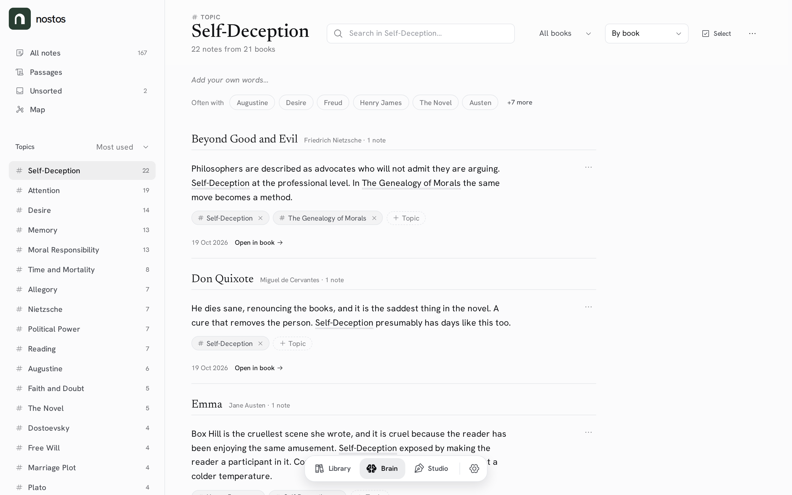
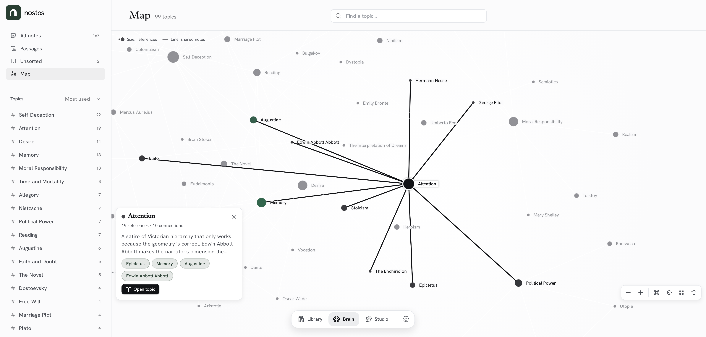

# The Brain

The Brain is where you return to what you noticed while reading. It has two
things in it, **notes** and **topics**, and one picture of how they connect,
the **map**. Everything else is a way to find a note or a topic.

It is built like the Library: a sidebar of places on the left and one reading
column of notes on the right. Topics play the part collections play for
books (`docs/brain-library-parity.md`). How topics live in a note's text is in
`docs/topic-system.md`.

## Places

| Place | Address | Shows |
| --- | --- | --- |
| All notes | `/brain` | Every note and passage, newest first |
| Passages | `/brain/passages` | Passages only (kind `passage`) |
| Unsorted | `/brain/unsorted` | Notes that declare no `[[Topic]]` |
| Map | `/brain/map` | The topic graph. `?focus=<topicId>` centres a topic |
| A topic | `/brain/topics/:id` | The topic's notes. `?with=<topicId>` narrows to notes shared with another topic |
| A note | `/brain/notes/:id` | One note on its own, for links from elsewhere |
| Sort one by one | `/brain/unsorted/sort` | Full screen, one unsorted note at a time |

`/second-brain` (the old Brain) redirects: `?topicId` and `?conceptId` to the
topic, `?noteId` to the note, anything else to All notes. The dock reopens
the last place you were in.

The sidebar lists the places with their counts, then the topics, most used or
A–Z. Hovering a topic (or selecting it, on a touch screen) shows Rename and
Delete.

## The list

Every place that lists notes has the same toolbar, and its state lives in the
URL so Back and shared links reopen the same view:

| Control | Options | Default | URL |
| --- | --- | --- | --- |
| Search | Note text, quote, book, author; matching topic names show as chips above the results | Empty | `q` |
| Book | All books, or one book that has notes in this place (with counts) | All books | `book` |
| Order | Newest first · Oldest first · By book | Newest first (By book on a topic) | `order` |
| Select | Checkboxes and the selection bar | Off | — |

They combine one way only: place AND book AND search, in the chosen order.
Active filters show as chips with a remove button above the list. Lists load
25 notes at a time; Back returns to the list where you left it.

**Selecting several notes** shows a bar with Add topic…, Keep with writing…
and Delete; adding a topic to many notes has Undo for exactly the notes it
changed.

## The note card

One card, everywhere a note appears (the Brain and a book's page):

- the quote, with the highlight colour's rail, cut after about five lines;
- your thought, where inline `[[topics]]` are links;
- topic chips: a chip opens the topic, its × removes the link (with Undo),
  **+ Topic** adds one (type to filter, Enter to link, a new name creates the
  topic; AI suggestions appear in the picker when AI is available);
- book · author · date · location, and **Open in book** (to the passage when
  its place in the book is known);
- a ⋯ menu: Edit note, Keep with writing…, More from this book, Select,
  Delete note; **View original** shows when the wording was changed at
  capture.

A passage shows its title and size, and **Read passage** opens the passage
viewer over the page.

Removing a topic turns `[[virtue]]` back into plain `virtue`, so no words are
lost.

## Topics

A topic page shows the name, **your own words** about the topic, how many
notes it has from how many books, and **Often with**: the topics that share
notes with it. Clicking one narrows the list to the shared notes, which is why
the two are related. The ⋯ menu holds Show on map, Rename, Merge into…, Keep
notes with writing… and Delete topic.

**Your own words** start as a quiet "Add your own words…" line under the
title. A click edits them in place (⌘/Ctrl+Enter or Save keeps them, Escape
cancels, saving nothing clears them); they show as paragraphs, and shortened
on the map card. A topic you described stays even when no note carries it.

## Sorting one by one

Unsorted has **Sort one by one**, a full screen with one note and one
question: which topics does it belong to? Enter adds a topic and, on an empty
field, saves and moves on. → skips, ← goes back, Esc leaves. Recent topics and
(when AI is on) suggestions are one tap away. The queue follows Unsorted's
book, search and order, and your place is remembered per account, so a reload
returns to the same note.

## The map

The map is the topic graph: a node's size is how many notes it has, a line
means two topics share notes. **Find a topic…** centres one. Selecting a topic
shows a card with its counts, your words (or a line from its newest note), the
topics it shares most with, and **Open topic**. Back returns to the map with
the same view and selection; **Show on map** on a topic page opens the map
centred on it.

## On a phone and on touch

- The toolbar is one row: the place name ▾ (it opens the sidebar as a
  drawer), then order, book, Select and the topic's ⋯ as square buttons; the
  search takes the next row, and Unsorted's **Sort one by one** the row after.
- Every control answers a 44px tap. Small ones (chips, the remove cross, the
  source link) keep their look and grow an invisible hit area.
- The dock stays at the bottom; the map runs under it.

## Tests and evidence

| What | Where |
| --- | --- |
| Screenshots | `Nostos.Frontend/e2e/visual-evidence/brain-rebuild/` (`part7-*`: every place, the sorter, selection and the map at 1280 and 390, light and dark, SelfHosted and Cloud) |
