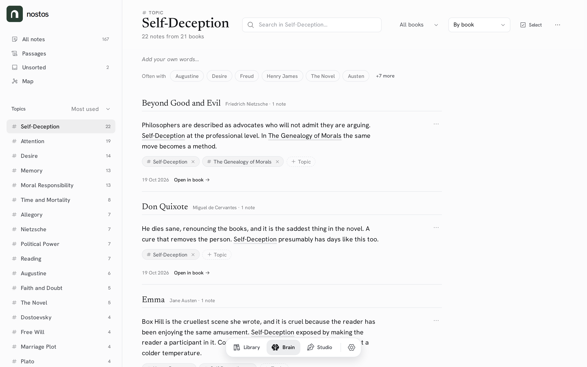
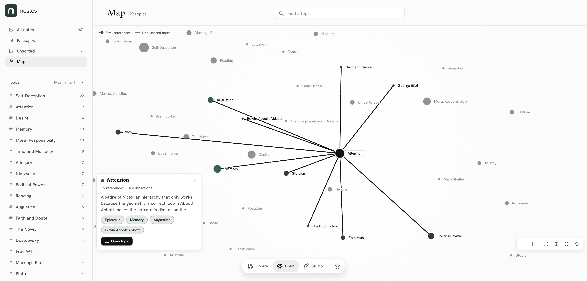

# The Brain

The Brain is where you return to what you noticed while reading. It has two
things in it, **notes** and **topics**, and one picture of how they connect,
the **map**. Everything else is a way to find a note or a topic.

It is built like the Library: a sidebar of places on the left and one reading
column of notes on the right. Topics play the part collections play for
books (`docs/brain-library-parity.md`). How topics live in a note's text is in
`docs/topic-system.md`.

## Places

| Place | Address | Shows |
| --- | --- | --- |
| All notes | `/brain` | Every note and passage, newest first |
| Passages | `/brain/passages` | Passages only (kind `passage`) |
| Unsorted | `/brain/unsorted` | Notes that declare no `[[Topic]]` |
| Map | `/brain/map` | The topic graph. `?around=<topicId>&depth=<1-3>&min=<n>` scopes to a local map around a topic; `?kinds=<id>,<id>` filters visible topic kinds (`none` for untyped); `?focus=<topicId>` centres a topic |
| A topic | `/brain/topics/:id` | The topic's notes. `?with=<topicId>` narrows to notes shared with another topic |
| A note | `/brain/notes/:id` | One note on its own, for links from elsewhere |
| Kinds | `/brain/kinds` | The kinds editor and the topic kind sorter. `?filter=<id>` (`untyped` for no kind, `assistant` for Ask Nostos, `connected-app` for a connected app) and `?q=` are in the URL |
| Sort one by one | `/brain/unsorted/sort` | Full screen, one unsorted note at a time |

`/second-brain` (the old Brain) redirects: `?topicId` and `?conceptId` to the
topic, `?noteId` to the note, anything else to All notes. The dock reopens
the last place you were in.

The sidebar lists the places with their counts, then the topics, most used or
A–Z. Hovering a topic with a mouse shows Rename and Delete; on touch each row
carries a dots-three menu with the same actions, so the count stays visible.

## The list

Every place that lists notes has the same toolbar, and its state lives in the
URL so Back and shared links reopen the same view:

| Control | Options | Default | URL |
| --- | --- | --- | --- |
| Search | Note text, quote, book, author; matching topic names show as chips above the results | Empty | `q` |
| Book | All books, or one book that has notes in this place (with counts) | All books | `book` |
| Order | Newest first · Oldest first · By book | Newest first (By book on a topic) | `order` |
| Select | Checkboxes and the selection bar | Off | — |

They combine one way only: place AND book AND search, in the chosen order.
Active filters show as chips with a remove button above the list. Lists load
25 notes at a time; Back returns to the list where you left it.

### On a wide screen

At 1280px and wider the list becomes an index and the note you choose opens
beside it, so reading several notes no longer means leaving the list. Opening
a note writes `?note=<id>` next to the current place and filters, so a reload,
a shared link and Back reopen the same note in the same list. ↑/↓ walk the
selection, Enter gives the note the keyboard, and Esc returns to the list.
With no note chosen the pane says so. Closing the sidebar gives its width to
the note. `/brain/notes/:id` still works: on a phone it is the full page, and
on a wide screen it opens the note in the pane. On narrower screens nothing
changes: the list and the note's own page are the same as before.

**Selecting several notes** shows a bar with Add topic…, Keep with writing…
and Delete; adding a topic to many notes has Undo for exactly the notes it
changed.

## The note card

One card, everywhere a note appears (the Brain and a book's page):

- the quote, with the highlight colour's rail, cut after about five lines;
- your thought, where inline `[[topics]]` are links;
- topic chips: a chip opens the topic, its × removes the link (with Undo),
  **+ Topic** adds one (type to filter, Enter to link, a new name creates the
  topic; AI suggestions appear in the picker when AI is available). **Edit
  note** opens the same words and pills in the note composer; how the two
  ways of adding a topic fit together is in `docs/topic-system.md`, "Writing
  a note";
- book · author · date · location, and **Open in book** (to the passage when
  its place in the book is known);
- a ⋯ menu: Edit note, Keep with writing…, More from this book, Select,
  Delete note; **View original** shows when the wording was changed at
  capture.

A passage shows its title and size, and **Read passage** opens the passage
viewer over the page.

Removing a topic turns `[[virtue]]` back into plain `virtue`, so no words are
lost.

## Topics

A topic page shows the name, **your own words** about the topic, how many
notes it has from how many books, and **Often with**: the topics that share
notes with it. Clicking one narrows the list to the shared notes, which is why
the two are related. The ⋯ menu holds Show on map, Rename, Merge into…, Keep
notes with writing… and Delete topic.

**Your own words** start as a quiet "Add your own words…" line under the
title. A click edits them in place (⌘/Ctrl+Enter or Save keeps them, Escape
cancels, saving nothing clears them); they show as paragraphs, and shortened
on the map card. A topic you described stays even when no note carries it.

Under the title, a **kind** pill ("Person") or a quiet "Add a kind" line opens
the kind picker: every kind with its colour, **No kind**, **New kind…** and
**Manage kinds**. The same picker opens from the selected topic's kind pill on
the map. Choosing here stores the source `reader`, so later AI runs never
overwrite it.

## Kinds

A kind says what a topic is: Person, Place, Idea, or the reader's own. One
kind per topic, or none, and at most twelve — one per palette colour
(`--map-kind-1..12`; untyped topics use `--map-kind-none`). The built-in
kinds are seeds and fully editable.

**The kinds editor** sits at the top of `/brain/kinds`: each kind shows its
colour swatch, name and how many topics it holds. The name renames in place.
The swatch opens the palette: colours no other kind holds are offered, and a
colour that is taken names its kind and offers a swap. The arrows reorder the
kinds (the map legend follows), and Delete asks first: "34 topics will have no
kind. The topics stay." **New kind** is disabled at twelve, and says why.

**The sorter** under it lists every topic with its note count, its kind pill
and who set it ("Set by Ask Nostos", "Set by a connected app", "Set by you").
The filters — No kind, a kind, or either source — and the name search are in
the URL, so `/brain/kinds?filter=untyped` is the map legend's **Sort them**
link and a shared link reopens the same view. Tick topics (shift-click takes a
range) and the bar sets one kind, clears it, or **Keep**s it: re-saving the
current kind as `reader`, so a later Ask Nostos run leaves the reader's choice
alone. One bulk request sets or clears up to 500 topics.

**Person?** is a small offline suggestion: when an untyped topic is named after
an author of a book in the library (accents, punctuation and case ignored; the
surname matches a full name), one click sets the Person kind as the reader's
choice. It reads the recent 500 books and never guesses from note text.

## Sorting one by one

Unsorted has **Sort one by one**, a full screen with one note and one
question: which topics does it belong to? Enter adds a topic and, on an empty
field, saves and moves on. → skips, ← goes back, Esc leaves. Recent topics and
(when AI is on) suggestions are one tap away. The queue follows Unsorted's
book, search and order, and your place is remembered per account, so a reload
returns to the same note.

## The map

The map is the topic graph: a node's size is how many notes it has, a line
means two topics share notes. **Find a topic…** centres one. Selecting a topic
shows a card with its counts, its kind pill, your words (or a line from its
newest note), the topics it shares most with, **Open topic**, and **Map around
this**. Back returns to the map with the same view, depth, strength, kind
filter and selection; **Show on map** on a topic page opens the local map
around that topic.

The **Colour** control switches between **Kind** (topic kind tokens
`--map-kind-1..12` and `--map-kind-none` for untyped topics), **Cluster**
(co-occurrence clusters), and **None** (uniform neutral colour). It defaults
to **Kind** once any topic has a kind, otherwise **Cluster**, and is
remembered per viewer. In **Kind** mode the stage legend lists every kind in
scope with a **No kind (n)** pill (with a **Sort them** link to
`/brain/kinds?filter=untyped`). A visible kind's count is what is actually
drawn after the cap; a hidden kind shows how many topics come back when it is
shown. Clicking any legend pill hides or shows that kind, storing the filter in
`?kinds=<id>,<id>` (`none` for untyped), so a filtered map can be shared and
Back returns to it; **Show all kinds** clears it from any colour mode. If the
kind list cannot be loaded, the map paints **Cluster** and hides the kind
legend rather than presenting typed topics as untyped. The filter applies before
the 150-topic cap, freeing room for the topics that remain, and a local map is
scoped on the whole graph first, so hiding a kind never shortens the path that
makes a topic "within N steps" — the root stays even when its own kind is
hidden.

When scoped around a topic (`?around=<topicId>&depth=<1-3>&min=<n>`), the root
sits pinned at the centre as the active node with neighbouring topics arranged
by hop distance (`depth` 1–3). **Strength** filters out weaker links below the
minimum shared-note count on both local and whole-brain maps, and keeping the
root's existing neighbours in place when changing depth or strength lets the
graph grow outward without re-shuffling. The scope chip's × returns to the
whole map; on a phone the scope chip and **Controls** sheet trigger sit in the
bottom HUD so the graph keeps the screen.

## On a phone and on touch

- The toolbar is one row: the place name ▾ (it opens the sidebar as a
  drawer), then order, book, Select and the topic's ⋯ as square buttons; the
  search takes the next row, and Unsorted's **Sort one by one** the row after.
- Every toolbar control answers a 44px tap. Small ones (chips, the remove
  cross, the source link) keep their look and grow an invisible hit area. The
  sidebar keeps the Library's 34px row rhythm; its dots-three row menu trigger
  carries the 44px target.
- The dock stays at the bottom; the map runs under it.

## Tests and evidence

| What | Where |
| --- | --- |
| Screenshots | `Nostos.Frontend/e2e/visual-evidence/brain-rebuild/` (`part7-*`: every place, the sorter, selection and the map at 1280 and 390, light and dark, SelfHosted and Cloud) |
| Local map | `Nostos.Frontend/e2e/visual-evidence/brain-local-map/` (whole map with Strength filter, `?around=<id>&depth=2&min=1`, and phone `Controls` sheet at 1280 and 390, light and dark, SelfHosted and Cloud) |
| Map kind colours | `Nostos.Frontend/e2e/visual-evidence/brain-map-kind-colours/` (whole and local map in Kind mode with `?kinds=` filter, legend and selected card kind pill at 1280 and 390, light and dark, SelfHosted and Cloud) |
| Setting kinds by hand | `Nostos.Frontend/e2e/visual-evidence/brain-topic-kinds/` (`before/` and `after/`: a topic with and without a kind, the picker open, the sorter with a selection, and the kinds editor with its palette at 1280 and 390, light and dark, SelfHosted and Cloud) |
